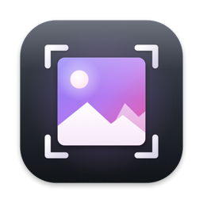

  

<h1 align="center">ImageTools</h1>

  Ridimensiona, converti e ottimizza le immagini in un solo passaggio · Apple Silicon · macOS 14 o successivo 
  Resize, convert and optimize images in one step · Apple Silicon · macOS 14 or later

  <a href="https://github.com/alecensi82/ImageTools/raw/main/ImageTools.dmg"><b>⬇ Scarica ImageTools / Download ImageTools</b></a> 
  <a href="CHANGELOG.md">Novità di ogni versione / What's new in each version</a>

---

## Italiano

ImageTools unisce in un'unica app il **ridimensionamento** (alla Resize Master) e l'**ottimizzazione** (alla ImageOptim): trascini immagini o cartelle e ogni file passa per tre fasi, Ridimensiona → Ottimizza → Esporta. App firmata e notarizzata da Apple.

- **Ridimensiona**: in percentuale, per larghezza o altezza, adatta a un rettangolo, ritaglia alle proporzioni (1:1, 4:3, 3:2, 16:9, 5:4 o personalizzate)
- **Converti** in JPEG, PNG, TIFF o HEIC, con spazio colore (sRGB, Display P3, Adobe RGB) e qualità a scelta
- **Metadati**: copia EXIF/GPS/IPTC, aggiungi autore e copyright, imposta i DPI
- **Filigrana** con un'immagine in 9 posizioni o a tutto schermo
- **Ottimizza** PNG, JPEG, GIF e SVG con OxiPNG, Zopfli, pngquant, JPEGOptim, MozJPEG, Gifsicle, svgcleaner e altri, senza perdita o con perdita controllata
- **Esporta** in una cartella a scelta (ricreando le sottocartelle) oppure sovrascrivendo gli originali
- Italiano e inglese, tema chiaro/scuro, colore di evidenziazione a scelta, statistiche dello spazio risparmiato
- **Aggiornamenti automatici** da questa pagina

### Installazione
Apri `ImageTools.dmg` e trascina ImageTools in **Applicazioni**.

---

## English

ImageTools combines **resizing** (like Resize Master) and **optimization** (like ImageOptim) in one app: drop images or folders and every file goes through three phases, Resize → Optimize → Export. Signed and notarized by Apple.

- Resize by percent, width, height, fit to a rectangle or crop to an aspect ratio
- Convert to JPEG, PNG, TIFF or HEIC with colour space and quality of your choice
- Copy metadata, add artist and copyright, set DPI, add an image watermark
- Lossless or lossy optimization of PNG, JPEG, GIF and SVG with the ImageOptim tool chain
- Export to a folder (subfolders are recreated) or overwrite the originals
- Italian and English, light/dark theme, accent colours, space-saved statistics
- Automatic updates from this page

### Install
Open `ImageTools.dmg` and drag ImageTools to **Applications**.

---

Optimization uses the open source tools bundled with ImageOptim by Kornel Lesiński, each under its own licence. Resizing features are inspired by Resize Master by Alexander Boltnev and Olga Kacher.
